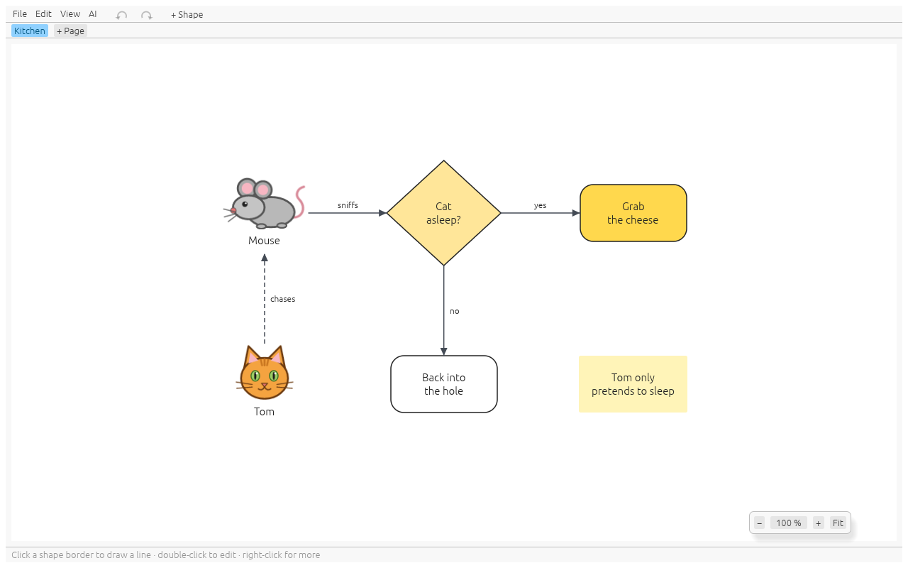

# whiteboxed

[](https://github.com/paxel/whiteboxed/actions/workflows/ci.yml)
[](https://github.com/paxel/whiteboxed/actions/workflows/security.yml)
[](https://github.com/paxel/whiteboxed/releases/latest)
[](https://crates.io/crates/whiteboxed)
[](https://github.com/paxel/whiteboxed/blob/summer/src/lib.rs)
[](https://github.com/paxel/whiteboxed/blob/summer/src/lib.rs)
[](LICENSE)

A WYSIWYG editor for [arc42](https://arc42.org) building-block views — draw.io for
architects who don't want to push pixels.

> Status: early development.

You describe your system as boxes and relations; whiteboxed does the layout. The
context view is level 0, and every box opens into its whitebox one level deeper, as
deep as you like. Relations that reach a box show up inside its whitebox, so the
levels cannot drift apart.


## What it does

- **Click, don't draw.** Click the side of a box where its partner should be: connect a
  new box, an existing one, or leave the relation open as a stub. Boxes grow with
  their relations; lines route themselves around boxes.
- **arc42 levels.** Context view with persons and external systems, then whiteboxes
  without a depth limit, a breadcrumb and a structure tree.
- **Consistent across levels.** Interfaces from the parent level enter a whitebox
  through its frame and are marked until a box inside takes them. Stubs bubble up to
  the context view.
- **Architecture box types.** Component, database, queue/topic, cache, file storage,
  UI, person, external system, and cross-cutting bands for concerns like logging.
- **Readable diagrams.** Lines run straight where boxes face each other, avoid
  crossings and jump where they must, and go under the diagram through numbered
  mouseholes where they would run over too many boxes; a readability colour per
  diagram says when it gets crowded and what helps.
- **Doodles.** File > New doodle sketches a data flow, a network or some logic on pages:
  whiteboard shapes, multi-line texts, colours, nested groups, dashed and dotted lines,
  same automatic layout, no arc42 rules.
- **Custom looks.** Your own SVG pictures for special boxes (Kafka, a company system, a
  device), from a file or drawn by the AI, in a library every file can use; inside, a
  box's look becomes its whitebox frame. Line looks give lines a kind of their own
  (width, dash, pictures at the ends), shown in the legend, and portals replace the
  mousehole arches.
- **Restructure without redrawing.** Group boxes into a new box, dissolve a whitebox,
  move a box up a level or into another box, split a coarse relation into precise
  ones; the relations follow on every level.
- **Tags** colour boxes project-wide.
- **Git-friendly files.** One YAML file per project with the model and grid cells, no
  pixel coordinates. Unsaved work is recovered after a crash.
- **arc42 texts.** A responsibility per box and a motivation per diagram, typed in a
  details panel; undo and redo from the toolbar arrows or the keyboard.
- **AI access.** An MCP endpoint lets Claude Code or another AI client read a repository
  and build the model while you watch; every AI step is one undo step, and access is
  off by default and needs a token.
- **Export** every diagram as SVG and PNG, together with arc42 text files
  (AsciiDoc or Markdown) holding the partner, building-block and interface tables,
  and an index that ties them together, or as one clickable HTML document.




The mouse and the cat are custom looks. You don't have to draw them yourself: ask the
AI through the MCP endpoint ("add a cat and a mouse look and use them"), and it draws
the SVG, adds it to your library with `add_look` and puts it on the shapes. The looks
then work in every file. Only a safe part of SVG is accepted (shapes,
paths, groups, gradients, text); anything else is refused with a message naming it.

## Documentation

- [Workflows](docs/workflows.md): step-by-step recipes, from the first box to the
  exported arc42 images.
- [Guide](docs/guide.md): levels, box types, relations, layout rules, restructuring,
  readability, AI access, keys and the file format.
- [Security audit](docs/security-audit.md): what an AI client with access can and
  cannot do, findings, dependency checks and how CI enforces them.

## Install

| OS      | Channel                                                                                        |
|---------|------------------------------------------------------------------------------------------------|
| Linux   | `brew install paxel/tap/whiteboxed`, or the plain tarball (x86_64)                             |
| macOS   | `brew install paxel/tap/whiteboxed`                                                            |
| Windows | `scoop bucket add paxel https://github.com/paxel/scoop-bucket` then `scoop install whiteboxed` |
| Any     | `cargo install whiteboxed` (builds from source)                                                |

On Linux, `brew install` puts whiteboxed into the application menu, and the app keeps
its menu entry and icon up to date on every start, however it was installed. Run
`whiteboxed-install-icon` if the entry is missing, and `whiteboxed-install-icon
--uninstall` before `brew uninstall` to remove it. The macOS build is **unsigned**;
start it from a terminal with `whiteboxed`.

## Running

```sh
cargo run --release                      # empty project
cargo run --release -- architecture.yaml # open a project
```

Windows, Linux and macOS. Built with Rust and egui/eframe.

## Development

```sh
cargo fmt --check
cargo clippy --all-targets --all-features -- -D warnings
cargo test                               # model, layout, editor and headless UI tests
cargo test --features render-tests       # also render the window (needs a GPU or lavapipe)
```

The render tests draw the real window through wgpu and check pixels. CI runs them on
Linux with software Vulkan (`mesa-vulkan-drivers`). The ignored `doc_screenshot_*`
tests regenerate the images in `docs/screenshots`:

```sh
cargo test --features render-tests --test render doc_screenshot -- --ignored
```

## License

[MIT](LICENSE)
