# Guide

whiteboxed draws the building-block view of [arc42](https://arc42.org) (section 5):
the context view, and for every box its whitebox one level deeper. You describe
boxes and relations; the app does the layout. It also keeps the texts arc42 asks for
next to each diagram and exports them. For step-by-step recipes see
[Workflows](workflows.md).

## The window

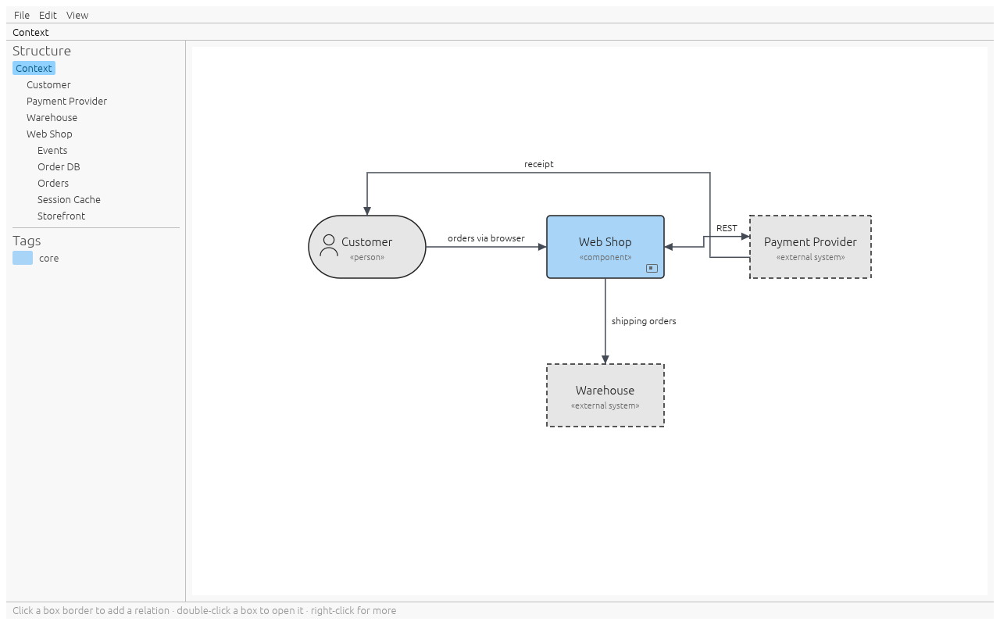

- **Menu bar**: File (new, open, save, export), Edit (undo, redo), View (fit, zoom,
  up one level), the **undo** and **redo** arrows, and **+ Box**, which adds a box without a
  relation in the next free cell. An arrow is grey when there is nothing to undo or
  redo.
- **Breadcrumb** under the menu: where you are, e.g. `Context › Web Shop › Orders`.
  Click any part to jump there. The dot after it is the current diagram's
  [readability](#readability).
- **Structure** (left): every box of the project as a tree. Click a box to show it in
  its diagram, double-click it to open its whitebox. A dot after a diagram shows its
  readability.
- **Tags** (left, below the tree): every tag with its colour.
- **Canvas** (centre): the current diagram. The buttons in its lower right corner zoom
  out (−) and in (+), show the zoom level (click it for 100 %) and fit the whole
  diagram (**Fit**). Ctrl + mouse wheel zooms at the pointer; dragging empty space
  pans. A diagram is fitted when you open it; after that the view stays where you put
  it, and a new box outside it is scrolled into view.
- **Details** (right): the **responsibility** of the selected box, or the
  **motivation** of the current diagram when nothing is selected, together with its
  readability and what helps. See [arc42 texts](#arc42-texts).
- **Status bar** (bottom): hints, errors, and the number of interfaces in this
  whitebox that are not attached to a box yet.

## Levels

| Level | Shows                                                       |
|-------|-------------------------------------------------------------|
| 0     | The context view: your system(s) and their neighbours       |
| 1     | The whitebox of a level-0 box: its building blocks          |
| 2, 3… | The whitebox of a box one level up; there is no depth limit |

A box is a blackbox on its own level. Opening it shows its whitebox: a frame with the
box's name, the boxes inside it, and every relation that reaches the box from outside.

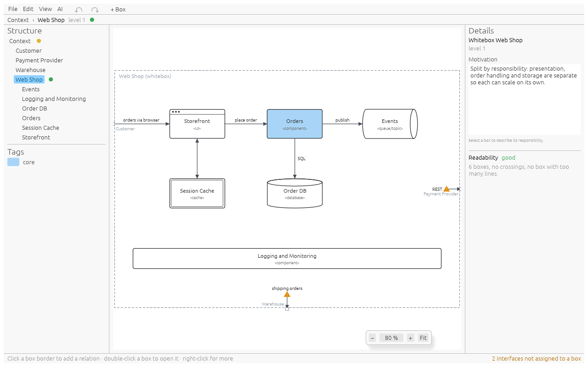

## Box types

| Type            | Drawn as                       | Where             | Opens into a whitebox |
|-----------------|--------------------------------|-------------------|-----------------------|
| component       | rectangle                      | every level       | yes                   |
| database        | cylinder                       | every level       | yes                   |
| queue/topic     | horizontal pipe                | every level       | yes                   |
| cache           | rectangle with a double border | every level       | yes                   |
| file storage    | folder                         | every level       | yes                   |
| UI              | window with a title bar        | every level       | yes                   |
| person          | rounded box with a figure      | context view only | no                    |
| external system | dashed grey rectangle          | context view only | no                    |

Every box has a **name**, unique within its diagram (case does not matter), a
**type**, and at most one **tag**. A small mark in the lower right corner shows that a
box has content in its whitebox.

### Cross-cutting bands

A concern that every part of a level uses, such as logging, security or monitoring,
can be a **cross-cutting band**: tick **Cross-cutting band** when you add or edit a
box. A band runs across the bottom of the diagram, below the grid; several bands stack
in the order you added them. A band is a real building block: it has a name, a type
and a responsibility, it can be opened into its own whitebox, and it appears in the
building-block table of the export. It has no lines, so it cannot be connected, and it
does not move. A box with lines has to lose them before it can be drawn as a band;
a band that stops being one goes to the next free cell.

### Custom looks

A box can wear a **look**: your own SVG picture, for boxes that deserve to be
recognised at a glance, such as Kafka, a company system or a device. Looks live in a
**library** in your user data directory (`whiteboxed/looks.yaml`), so every file can
use them.

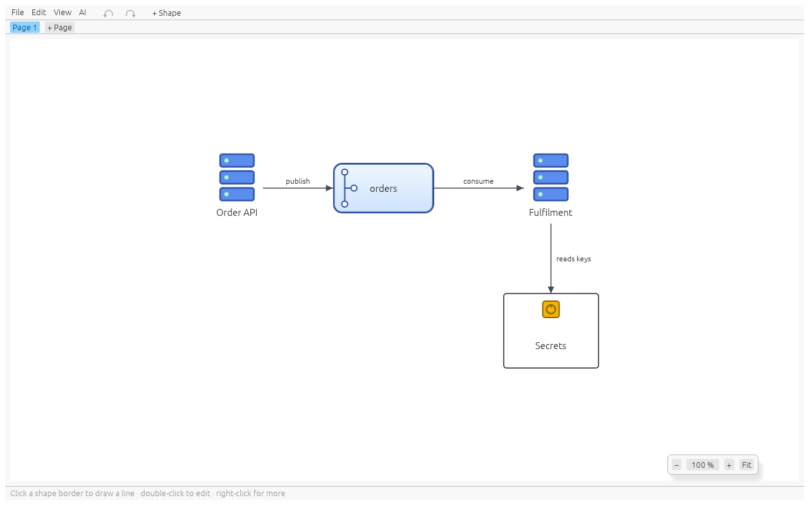

Each look is shown in one of three ways, chosen when it is added:

- **shape, name inside**: the picture is the box, with the name written on it;
- **shape, name below**: the picture is the box, with the name under it;
- **icon above the name**: the box keeps its own shape and shows the picture above the
  name; the box grows by the icon.

A picture is always scaled to keep its proportions, never stretched, and the empty
margin around its drawing is cut off, so lines reach the drawing itself. With the
name below, the picture is the box: lines from the left, right and top reach it, the
name sits in a small frame under it (wider than the picture if need be), and a line
from below lands on that frame. When a side needs room for more lines, the whole
picture grows. In a project the look goes on top of the box type: choose it under
**Look** in the box's dialog; the type and its rules stay. In a doodle the looks
appear at the end of the **Shape** list.

Inside a whitebox, the **frame** is the box's own look, stretched: the corners keep
the size they have on the box, the edges and the middle stretch (a nine-slice). With
the name below, the title sits in a small frame under the picture, as outside; an icon
look leaves the frame plain and puts the icon next to the title.

**File > Looks…** shows the library: rename a look by editing its name, delete it, or
**Import .svg…** a picture (named after the file, shown the way chosen next to the
button). The AI can add looks too (`add_look`).

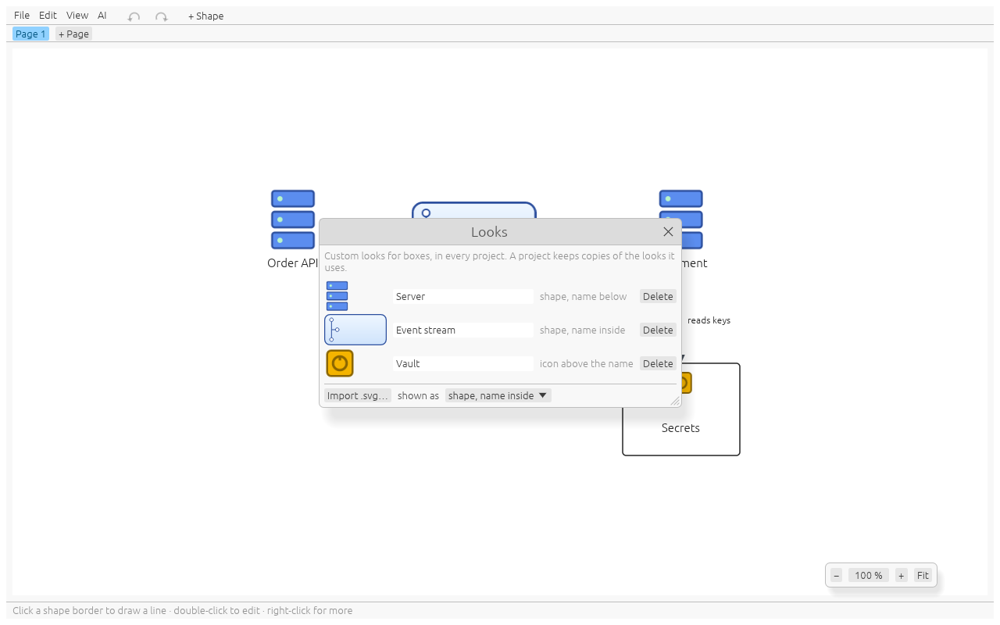

A project keeps a **copy** of every look its boxes wear, so it shows the same on
another computer. When a project is opened, it takes the library's version of a look
if that is newer (renamed or replaced); a look deleted from the library stays in the
projects that use it, and is offered again in their dialogs. Pictures and line looks
(below) are kept and taken over the same way.

#### Pictures and line looks

The library also holds **pictures**: SVGs without a mode, for the ends of lines and
for [mouseholes](#mouseholes). A picture is never worn by a box. On a line it is drawn
pointing right with its tip at the right edge of its viewBox, scaled to the height of
an arrowhead, and turned along the line; whatever it draws in `currentColor` takes the
line's colour, other colours stay. Import one with **Import picture .svg…** in the
Looks dialog, or let the AI draw it (`add_picture`).

A **line look** is a kind of line: a name such as *async* or *data flow*, a stroke
width, a dash (solid, dashed or dotted) and a **head** and a **tail** picture. A line
wears it on every level: pick it under **Look** in the line's **Edit…** dialog or in
the Connect dialog. The line's direction says which ends get the head (without a head
picture they get the plain arrowhead) and which the tail, which is usually nothing;
colour, direction and text stay on the line. Lines bundle only when they share look,
pattern and colour. The legend shows a sample of every line look on the diagram with
its name, and the kinds of line in use count for [readability](#readability). Add
and edit line looks in the Looks dialog (**Add line look**), or with `add_line_look`.

Only a safe part of SVG is accepted: `svg`, `g`, `defs`, `path`, `rect`, `circle`,
`ellipse`, `line`, `polyline`, `polygon`, `text`, `tspan`, `linearGradient`,
`radialGradient` and `stop`, with their geometry, paint and text attributes and
references inside the picture (`url(#name)`). Anything else (scripts, styles, images,
links, filters, references to files or the web) is refused with a message naming what
is not allowed; nothing is silently removed. Draw with attributes like
`fill="#f80"` instead of `style="fill:#f80"`. The same check runs on every look in a
project file you open.

## Relations

A relation connects two boxes of the same diagram. It has:

- a **direction** seen from the box you started at: **out** (arrow to the other box),
  **in** (arrow to your box), **bi** (both) or **none** (a plain line without arrows;
  the documentation lists it as both input and output of a communication partner);
- an optional **text**, shown next to the line;
- an optional **short label**, shown on the line instead of a long text;
- a **line style**: the project's, or its own (square corners, slightly rounded,
  rounded or curved);
- a **colour**: the default, or any colour from the picker in the **Edit…** dialog. It
  is the relation's, so its line has it on every level; lines of different colours
  between the same boxes are not bundled;
- the **side** of each box it leaves from. It follows the layout (see
  [Layout](#layout)); you can pick another one in the relation's **Edit…** dialog,
  until one of its boxes moves.

Two boxes can share several relations, e.g. a REST call one way and events the other.
They are drawn as **one line** (a bundle): its label lists their texts, and its arrows
show every direction that occurs. Right-click the line to edit or delete each of them
by name; double-click it to choose one. Inside the whiteboxes, where they land on
different boxes, they are separate lines again. **Bundle relations between the same
boxes** in [Project settings](#project-settings) turns this off.

### Long texts and the legend

A text longer than the limit in [Project settings](#project-settings) (24 characters
out of the box) is not written on the line. The line shows its short label, or a
number like `[2]` if it has none, and the full text goes to a **legend** below the
diagram. Numbers count the relations of the diagram in order. In the app, hovering a
line shows its full text. The legend is part of every export; the tables of the
documentation export always carry the full texts.

### Relations across levels

When a relation reaches a box, it also shows up inside that box's whitebox: it enters
through the frame on the side nearest the box inside that takes it (before any box
takes it, on the side it has one level up), labelled with the partner outside. To
put it on another side, drag its end (the small square on the frame) to that side, or
choose **Enters at** in the line's **Edit…** dialog; **automatic** gives the choice
back. A side you chose stays when boxes move. The label goes
as deep as the boxes around it: if the partner's end lands inside the partner, you see
where, for example `B › b1, b2`. A name longer than the label limit becomes `B › [3]`,
with the full name in the legend. Inside, you
**attach** it to the box that actually handles it. Until then it ends in an orange
warning marker, and the status bar counts it. Attaching it to further boxes fans the
line out: one frame point, one label, a branch to each box. Where the layout gives
branches frame points of their own (to keep the picture free of crossings, or for
their mouseholes), the relation is multiplied, and the same text at every point
would leave you guessing whether it is one thing or several: each point then shows
a legend number with its place in the group, `[1] 3/6`, the branches carry no text,
and the legend names the relation once with its partner, `use cases — HTTP API › …`.
Holes of such a branch show the same, `1 3/6`.

When one coarse relation turns out to be several flows, **Split relation…** (right-click
the line) makes them precise. A grid lists the boxes the relation reaches at both ends
(rows and columns); every pair you tick becomes its own relation with its own text and
direction, landing on exactly those two boxes.

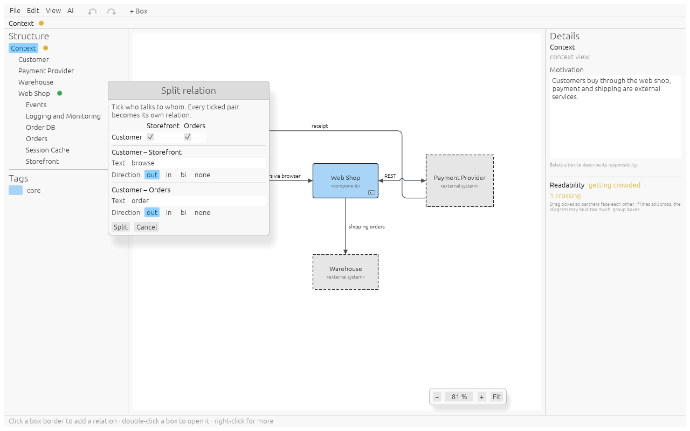

On the level above they are still drawn as one line (see bundling above); inside, every
box sees exactly its partner.

Deleting such a line inside a whitebox only detaches it there (a branch: only from
that box); the relation itself stays on its own level.

### Mouseholes

A line that would run straight over more than two boxes, or whose going under
saves the picture about three crossings or more, goes through **mouseholes**
instead: out of its box a short way into a numbered hole, and out of the hole with
the same number near its other end; nothing is drawn in between. The number is the
line's number in the [legend](#long-texts-and-the-legend), which always holds its
text; a line without text is listed by its two ends (`Orders → Billing`). A short
label is written at the holes as well. Several relations drawn as one line share a
pair of holes carrying all their numbers (`2,5`). Inside a whitebox the end at the
frame can be a hole, and of a fanned-out relation only the branches that need it go
under. A branch that crosses too much first gets a frame point of its own, in line
with its box, and stays drawn when that is enough, carrying the text as well. A
branch that goes under has a
frame point and a pair of holes of its own, with a number of its own, so you can pair
its holes; the legend lists it with the box it reaches (`use cases › Provide`).

In the app, hovering a hole highlights both holes and shows the route between them
faintly; clicking one selects the line. **Mouseholes** in the line's **Edit…** dialog
sets it for the diagram shown: **automatic**, **always** or **never**. Lines through
mouseholes count for [readability](#readability).

The holes are arches in the line's colour, always with the round side up, or
**portals**: two pictures from the
library, chosen under **Mouseholes** in [Project settings](#project-settings), one
where a line goes in (near its tail) and one where it comes out (near its head). A
line without a head goes in at its first end. Portals keep their own colours, like the
blue and the orange one of a certain game; the number next to them is written in the
line's colour.

### Stubs

A **stub** is a relation whose other end is not known yet, drawn with an open circle.
A stub you create inside a whitebox leaves that level: every enclosing box shows it on
the same side, up to the context view. You can connect it on any of those levels by
clicking its open end.

## Layout

There is nothing to position by pixel.

- Every diagram is a grid. A box occupies one cell; columns and rows take the size of
  their largest box.
- Lines on one side of a box keep 40 px apart, so a box grows along a side from its
  second relation there. A box never gets smaller than its minimum size.
- Lines run horizontally and vertically through the gaps between cells and never
  through a box. While a whitebox has [cross-cutting bands](#cross-cutting-bands), a
  relation entering it never takes the bottom side on its own, since the bands lie
  there; a side set to bottom by hand goes under the bands through a pair of
  [mouseholes](#mouseholes) at their edges. Gaps widen
  to fit long labels and the lines that run along them, which keep 40 px apart.
- A line leaves a box in the middle of its side. Two boxes facing each other are
  joined by a straight line, also across empty cells, as close to both middles as
  their sides allow. Boxes that lie diagonally are joined with one bend through free
  cells, from the middle of one side into the middle of the other; where that would
  run through a box, or cross more lines than the gaps do, the line takes the gaps.
- Routes, lanes, the order of the lines on each side, mouseholes and the frame
  points of fanned-out relations are chosen together, by one measure over the whole
  picture: crossings, lines running along each other, holes and lines through the
  title or a band count most, then bends, short steps and length. A line goes under
  only where that saves about three crossings; a branch gets a frame point of its
  own before that. Where two lines still cross, the horizontal one jumps over the
  other in a small arc. No line runs along another relation's line: where two would
  share a stretch, one of them moves half a lane along its box.
- A label sits on a stretch of its line with room for it, clear of boxes and of other
  lines: above or below a horizontal stretch, right or left of a vertical one. A label
  with no such place shows its legend number instead, with the text in the legend
  (unless shortening is turned off). Labels stay inside the whitebox frame, wrapped
  onto several lines if needed.
- The side you click is the side the partner ends up on. A new box goes to the cell
  next to it. Several new boxes on the same side fill a block that stays as square as
  possible: 2 side by side, then 2×2, 3×2, 3×3 …
- Relations from the level above enter a whitebox opposite the box that takes them,
  in line with its port, so the line runs straight. The partner names along the top
  and bottom of the frame make room for that: beside their end, in the first row
  where no line, name or title is in the way, wrapped into the gap between two
  lines when it is narrow. A name that fits in none of the rows next to the frame
  shows its legend number instead (unless shortening is turned off).
- Connecting an **existing** box on a side moves it there. If that would break the side
  of another relation, the app asks: **move** it (default) or **keep** it and route
  the line around.
- You can still move a box: drag it to another cell, or select it and use the arrow
  keys. A box already in that cell swaps places with it. After a move, the lines of
  the moved boxes leave them on the sides facing their partners, also where you had
  picked a side by hand.
- The same project always gives the same picture.

## Restructure

When a box turns out to be on the wrong level, move it instead of rebuilding. All of
it is in the right-click menu of a box:

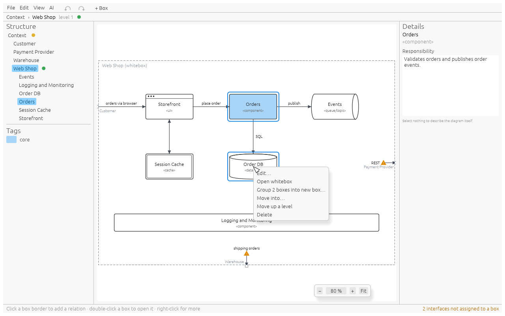

- **Move up a level** (right-click a box inside a whitebox): the box leaves the
  whitebox, with everything inside it, and lands next to its old whitebox box on the
  side its lines point to. Its lines follow: a line to a box of its old whitebox now
  enters the old whitebox and lands on that box there. A line from outside that landed
  on it now goes to it directly; if it also landed on other boxes, it becomes one
  relation per box.
- **Move into…** (right-click a box, then click another box of the same diagram):
  the reverse. The box, with everything inside it, goes into the other box's
  whitebox, next to the box there it has the most lines with. A line to the other box now lands on the box
  inside; a line that reached nothing inside becomes an open end.
- **Group into new box…**: Ctrl+click boxes to select several (Ctrl+click again takes
  one out), then right-click one of them. You name the new box; it takes the cell of
  the box you right-clicked, and the selected boxes go into its whitebox in the same
  arrangement. Lines between them move inside; lines to the outside now reach the new
  box and land on the right box inside.
- **Dissolve whitebox…** (right-click a box with content): the boxes inside take the
  box's place, keeping their arrangement; the boxes around move aside. The box itself
  goes, with its responsibility and motivation (the confirmation names them). A line
  that landed on several boxes inside becomes one relation per box; a line that
  reached no box inside becomes an open end at its partner.

Together they cover moves between levels: to take a database out of Business so that
Health can use it too, **Move up a level** the database (or dissolve Business, then
group the rest again).

Each restructuring is one step for undo.

## Readability

Every diagram gets a colour: green (good), yellow (getting crowded) or red (hard to
read). It shows as a dot next to the diagram in the structure tree and next to the
breadcrumb (on a doodle page: on its tab); hovering it names the causes. With nothing
selected, the details panel lists each cause with what helps.

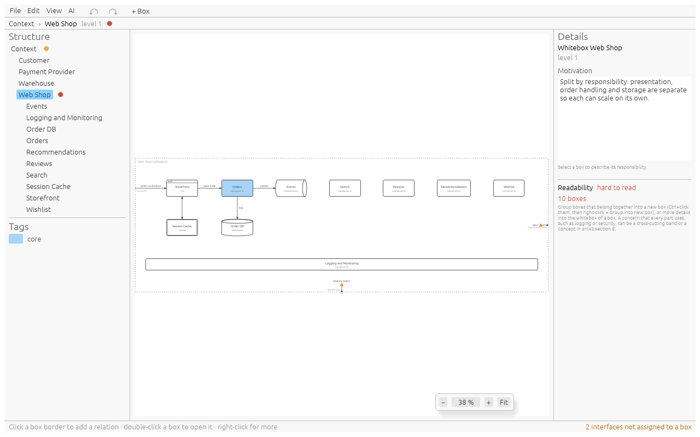

| Measure                  | Yellow from | Red from | What usually helps                                   |
|--------------------------|-------------|----------|------------------------------------------------------|
| Boxes in the diagram     | 8           | 10       | Group boxes, move details into a whitebox, bands     |
| Lines that cross (*)     | 1           | 3        | Rearrange so partners face each other, or group      |
| Lines on the busiest box | 6           | 9        | Split the box, or move its partners into its whitebox |
| Lines through mouseholes | 3           | 5        | Move partners closer, or set lines to never go under  |
| Line looks in use        | 3           | 5        | Fewer kinds of line; say the difference in the texts   |

(*) A line running along another relation's line counts as a crossing here.

The worst of the five gives the colour. The limits are a rule of thumb, not part of
arc42: arc42 asks for a level 1 with the major parts of the system and lets you refine
only the boxes that need it. Change them under [Project settings](#project-settings).
Concerns that every part uses, such as logging or security, are often better a
cross-cutting band, or a rule in arc42's crosscutting concepts (section 8), than more
boxes. The score is a working aid; exports do not show it.

## Project settings

**File > Project settings…** holds what applies to the whole project:

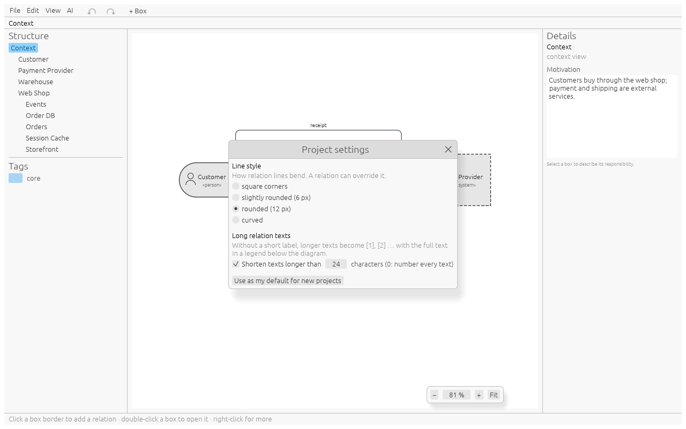

- **Project name**: shown in the window title, offered as the file name on the first
  save and used as the title of the exported documentation. Until you type one, the
  project is named after the first box of the context view that is not a person or an
  external system, and follows its renames. Empty the field to go back to that.
- **Line style**: how relation lines bend. A relation can override it in its
  **Edit…** dialog.
- **Shorten texts longer than … characters**: from which length a text moves to the
  legend (see [Long texts and the legend](#long-texts-and-the-legend)). 0 numbers
  every text; unticked, texts are never shortened.
- **Bundle relations between the same boxes**: draw them as one line (on by default).
- **Readability**: from how many boxes, crossings and lines on one box a diagram
  counts as crowded (yellow) or hard to read (red).
- **Use as my default for new projects** keeps the current line style for every new
  project on this computer.

## arc42 texts

arc42 describes every level with a few texts besides the diagram. whiteboxed keeps
two of them and builds the tables from the model:

| Text           | Where                            | Typed in                             |
|----------------|----------------------------------|--------------------------------------|
| Responsibility | every box                        | Details panel, with the box selected |
| Motivation     | the context view, every whitebox | Details panel, with nothing selected |

Relation texts serve as the interface descriptions. Typing stays in the field until
you leave it; then the change becomes one step for undo. Inside the field, Ctrl+Z
undoes your typing only.

## Tags

Type a tag name in the box popup. Tags are project-wide: the same tag has the same
colour on every level. A new tag gets the next colour of a 10-colour palette; click
its swatch in the sidebar to pick another.

## Files

A project is one YAML file. It holds the boxes, relations, tags and the grid cell of
each box, never pixel coordinates, so a diff shows what changed in the architecture.
Lists are written in a fixed order. See [the file format](#file-format) below.

- **Ctrl+S** saves; the first save asks for a file name.
- Two seconds after every change, the app writes a **recovery file** in your user data
  directory (`whiteboxed/recovery`). Saving removes it. If the app crashes, the next
  start offers to restore the unsaved work.
- Closing, opening or starting a new project with unsaved changes asks first. Enter
  saves, Esc keeps editing.
- **File > Open recent** lists the last 10 files you opened or saved. A file that is
  gone is greyed out, with **Remove** next to it.
- On start the app **reopens the last file**, unless you name a file on the command
  line. **File > Preferences…** turns this off.
- **Open** and **Save as** start in the folder you used last.
- A file opens on the diagram (or doodle page) and at the zoom it showed when you
  last left it.
- The window opens where you left it, at the same size (or maximized), and the side
  panels keep their widths. A window left on a monitor that is gone opens centred on
  the main one.
- Recent files, folders, the window, the panels and each file's diagram and zoom are
  remembered in your user data directory (`whiteboxed/state.yaml`), never in a
  project.

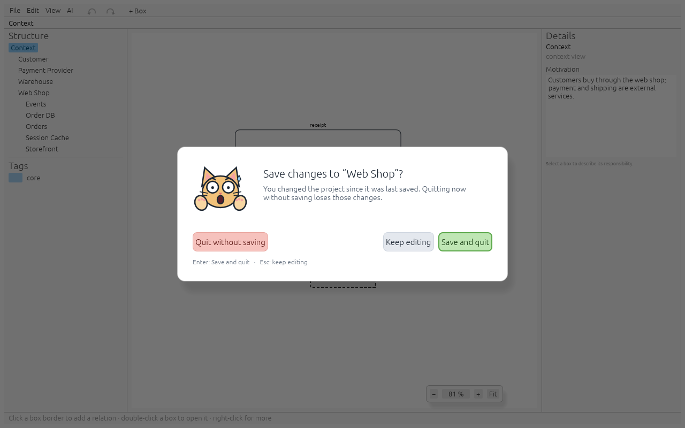

## Export

**File > Export…** opens one dialog for everything. Exports look exactly like the
canvas.

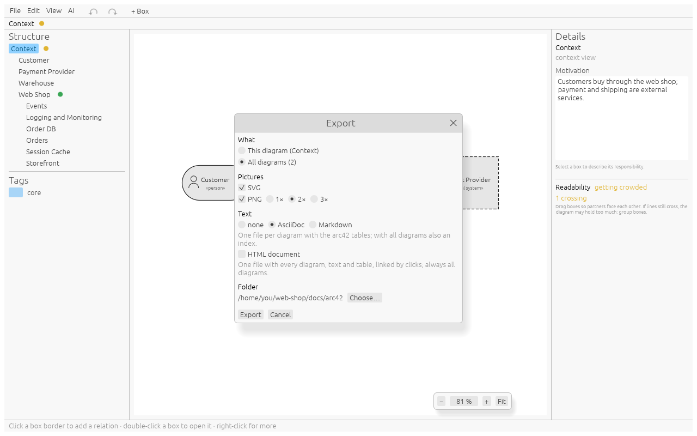

- **What**: the diagram on screen, or all diagrams (the context view and every
  whitebox with content).
- **Pictures**: SVG, and PNG at 1×, 2× or 3× the canvas size, named after the
  breadcrumb (e.g. `context - Web Shop.svg`).
- **Text**: none, AsciiDoc or Markdown: a text file per diagram with the same name
  (`context - Web Shop.adoc` or `.md`). With all diagrams also `index.adoc` or
  `index.md`, which puts them in order: the context first, then the whiteboxes level
  by level.
- **HTML document**: one file named after the project (e.g. `Web Shop.html`) with
  every diagram, its motivation and tables. It needs nothing else: no internet, no
  other files. Click a box to open its whitebox or see its row, a line or its label to
  see its interface, the name at a frame end to go to that partner one level up; a
  row of an interface table points back at its line. A tree on the left and the
  breadcrumbs lead through the levels. It follows the light or dark setting of the
  system, the button in the top right corner switches, and it always prints light.
- **Folder**: where the files go. A missing folder is created.

The dialog remembers your choices in the project file, so the next export of a
checkout writes to the same place. The folder is kept relative to the project file
when both lie in the same repository (the nearest folder with a `.git`), else as an
absolute path; the dialog says so.

The context file holds the image, the motivation as explanation, and two tables. A
partner's description is the responsibility typed for that person or external system.

| Table                  | Columns                             | From                                                      |
|------------------------|-------------------------------------|-----------------------------------------------------------|
| Communication partners | Partner, Description, Input, Output | the partners' responsibility and the arrows to your boxes |
| Building blocks        | Name, Responsibility                | your own boxes                                            |

A whitebox file holds the image, the motivation and three tables:

| Table                     | Columns                                      |
|---------------------------|----------------------------------------------|
| Contained building blocks | Name, Responsibility                         |
| External interfaces       | Partner outside, Attached to, Direction, Text |
| Internal relations        | From, To, Direction, Text                    |

An interface attached to no box yet appears as "not attached"; an empty cell shows "–".
Each file starts at heading level 3 (`===` / `###`), so it fits under a chapter of
your own arc42 document: `include::context - Web Shop.adoc[]` in AsciiDoc. In
Markdown, which has no includes, the index links the files.

## AI access (MCP)

An AI client can build and change the open project while you watch. whiteboxed offers
its editing operations as [MCP](https://modelcontextprotocol.io) tools on
`http://127.0.0.1:<port>/mcp`.

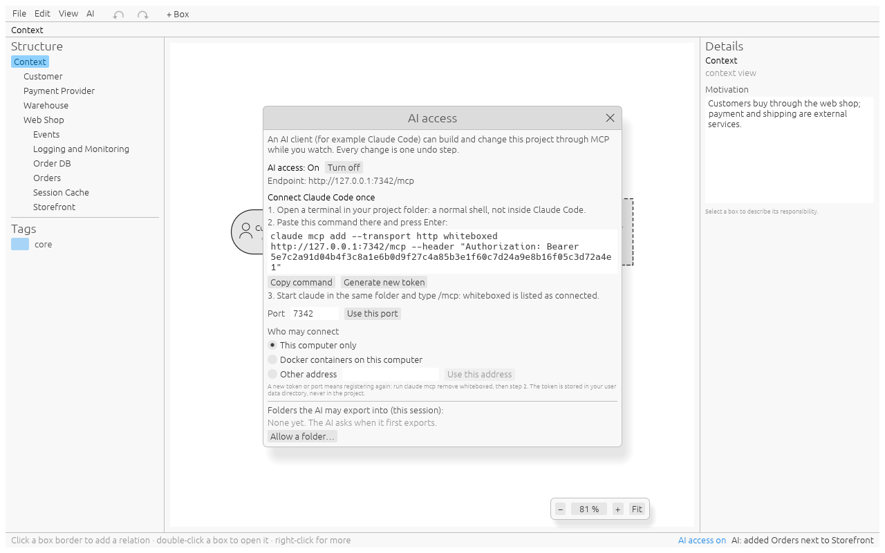

- **Connecting Claude Code** takes three steps, listed in the dialog under **AI >
  Connection…**: open a terminal
  in your project folder (a normal shell, not inside Claude Code), paste the copied
  `claude mcp add` command there, then start `claude` and check with `/mcp` that
  whiteboxed is connected.
- **Off by default.** **AI > Allow AI access** turns it on until you turn it off or
  quit; the next start begins with it off. The dialog opens on its own only when the
  endpoint cannot start.
- **Token.** Every request needs the access token, as `Authorization: Bearer <token>`
  or as `?token=<token>` in the URL. The token is made once per user and stored in
  your user data directory (`whiteboxed/ai.yaml`), never in a project. **Generate new
  token** in the dialog replaces it; clients then need the new one.
- **Who may connect.** **This computer only** (the default) listens on `127.0.0.1`.
  **Docker containers on this computer** lets an AI client in a container connect as
  `http://host.docker.internal:<port>/mcp`; on Linux start the container with
  `--add-host=host.docker.internal:host-gateway`, and whiteboxed listens on the Docker
  bridge only. **Other address** listens on an IP address you type: every machine
  that reaches it can try to connect, and only the token keeps them out. The command
  in the dialog uses the matching address. See the
  [security audit](security-audit.md) (S15).
- **Port.** 7342 unless you choose another in the dialog. A port that is taken shows an
  error instead of silently moving.
- **Same rules as a click.** Every tool call goes through the same checks as the GUI
  and is **one undo step**. A refused call changes nothing and tells the AI why.
- **Follow AI** (AI menu, on by default) shows the diagram the AI just changed. The
  status bar shows "AI access on" and the last change; click it to go there.
- **Exports need your permission.** `export_docs` only writes into folders you allowed
  for this session. The first export into a new folder fails and whiteboxed asks
  **Allow for this session / Don't allow**; the AI then tries again. The AI dialog
  lists the allowed folders, can revoke them and can allow one in advance. Exports
  never follow symbolic links out of an allowed folder.
- **What the AI may not do:** save, open or start a project, read files, or run
  anything. That stays with you. The one thing it writes outside the project is your
  library of looks (`add_look`, `add_picture`, `add_line_look`), and only pictures
  that pass the SVG check.

| Tool                 | Does                                                              |
|----------------------|-------------------------------------------------------------------|
| `get_model`          | The whole project as JSON                                         |
| `get_diagram`        | One diagram: boxes, lines, open ends, problems, readability score |
| `render_diagram`     | One diagram as PNG, as you see it                                 |
| `add_box`            | A box without relation, or with `band: true` a cross-cutting band |
| `connect_new`        | A new box on one side of a box, connected; `look` for the line    |
| `connect_existing`   | Two boxes of a diagram; `placement` move (default) or keep; `look` |
| `add_stub`           | A relation that leaves the level                                  |
| `connect_open_end`   | A stub's open end to a box                                        |
| `attach`             | A relation from the level above to a box inside; again: fans out  |
| `edit_box`           | Name, type, tag, look                                             |
| `edit_relation`      | Direction, text, short label, style, colour, mouseholes, sides, look |
| `set_responsibility` | A box's responsibility                                            |
| `set_motivation`     | A diagram's motivation                                            |
| `move_box`           | A box to another grid cell                                        |
| `move_up`            | A box out of its whitebox, one level up                           |
| `move_into`          | A box into the whitebox of another box                            |
| `group`              | Boxes of one diagram into the whitebox of a new box               |
| `dissolve`           | A whitebox: its boxes take the box's place one level up           |
| `split_relation`     | One relation into several, one per pair of boxes                  |
| `delete_box`         | A box; one with content only with `recursive: true`               |
| `delete_relation`    | A relation; with `detach_in` (and `landing`) only inside there    |
| `export_docs`        | Images, arc42 texts, index (and HTML) into a folder you allowed   |
| `batch`              | Several editing calls as one undo step, all or nothing            |
| `list_looks`         | The looks, pictures, line looks and portals of the library and the project |
| `add_look`           | A look (name, SVG, mode) into your library; same name: replaced   |
| `add_picture`        | A picture (name, SVG) for line ends and portals; same name: replaced |
| `add_line_look`      | A line look (name, width, dash, head, tail) into your library     |
| `set_portals`        | The pictures drawn as mouseholes (`in`, `out`; "" is the arch)    |

The look tools also work with a doodle open. `add_look`, `add_picture` and
`add_line_look` change your library, which undo does not reach, so they cannot run in
a `batch`.

With a **doodle** open, the AI works with the `doodle_` tools instead, and the tools
above refuse (and the other way round). Doodle tools address pages, shapes, groups
and lines by id, since texts may repeat:

| Tool                  | Does                                                    |
|-----------------------|---------------------------------------------------------|
| `doodle_get`          | Every page with its shapes, groups, lines, readability  |
| `doodle_render`       | One page as PNG                                         |
| `doodle_add_page`     | A new page; `doodle_rename_page`, `doodle_delete_page`  |
| `doodle_add_shape`    | A shape with text, shape type or look, colour and cell  |
| `doodle_edit_shape`   | Text, shape type, look or colour of a shape or group    |
| `doodle_move_shape`   | A shape to another cell                                 |
| `doodle_delete_shape` | A shape or group                                        |
| `doodle_add_line`     | A line between two shapes or groups, pattern, colour, look |
| `doodle_edit_line`    | Text, direction, pattern, colour, mouseholes, look      |
| `doodle_delete_line`  | A line                                                  |
| `doodle_group`        | A group framed around shapes; `doodle_widen_group`      |

The problems `get_diagram` lists are lines that cross (both relations and where),
lines running along each other (both relations and the stretch), labels on top of
each other, labels over a box or across another line, and labels that do not fit
inside the frame or the picture. The AI can then tidy the diagram with `move_box`.

Boxes are addressed by id or by their path of names from the context view, as a list
(`["Web Shop", "Orders"]`) or as one string (`"Web Shop/Orders"`). Names compare
without case. The context view is the default diagram.

## Doodles

Not every box-and-line picture is an architecture. **File > New doodle** starts a free
sketch for a data flow, a network or a bit of logic, without the arc42 rules:

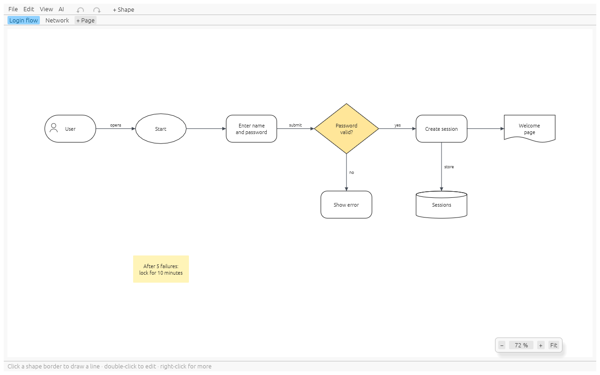

- A doodle has **pages**, shown as tabs under the menu. **+ Page** adds one; double-click
  a tab (or right-click it) to rename it; right-click > **Delete page** removes it (the
  last page stays).
- No levels and no whiteboxes: shapes do not open, there is no breadcrumb, structure
  tree or details panel.
- Every page gets a [readability](#readability) colour, as a dot on its tab; hovering
  it names the causes and what helps. Shapes count instead of boxes, groups do not
  count, and the limits are under **File > Project settings…**.
- **Shapes**: rectangle, rounded rectangle (a step), circle (start, end), diamond (a decision),
  cylinder (data), document, cloud (a network, the internet), person, and note (text
  without a border; with a colour it becomes a sticky note). Lines reach the outline
  of round and pointed shapes.
- A shape's text can span several lines: in its dialog, Enter starts a new line and
  Ctrl+Enter confirms. The same text may appear more than once.
- Every shape can get its own **colour** from the palette in its dialog.
- **Groups** mark zones, lanes or networks: Ctrl+click shapes, then right-click one >
  **Frame as group…** and name it. The frame is a rectangle of cells around them, and
  every shape inside the rectangle belongs to the group, also one moved in later.
  Groups may lie inside other groups, but not partly over them. Right-click a group's
  name > **Widen to the selection** grows it around further Ctrl+clicked shapes. A
  line can end at a group's frame ("Internet → DMZ"); lines cross frames freely.

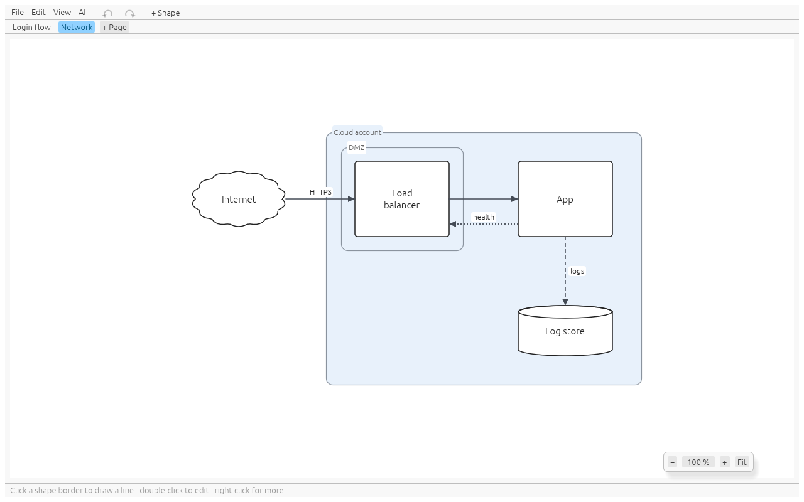
- Lines connect two shapes; there are no open ends (stubs). In a line's **Edit…**
  dialog, **Pattern** makes it solid, dashed or dotted, for example for asynchronous
  or optional flows, and **Colour** gives it a colour of its own. Lines with different
  patterns or colours between the same shapes are not bundled. Long lines go through
  [mouseholes](#mouseholes) here too.
- Placing, connecting by clicking a border, routing, line styles, undo and saving work
  as in a project.

**File > Export…** writes the current page or all pages as SVG and PNG (named after the
pages), and the **HTML document**: one file with every page as a tab. A doodle has no
arc42 texts to export.

A doodle is saved like a project, as YAML with `kind: doodle` at the top; **File >
Open** opens both.

## Keys

| Key                   | Does                                   |
|-----------------------|----------------------------------------|
| Enter                 | Confirm a popup; open the selected box |
| Esc                   | Close a popup; stop picking; deselect  |
| Backspace             | Up one level                           |
| F2                    | Edit the selected box                  |
| Delete                | Delete the selected box                |
| Arrow keys            | Move the selected box one cell         |
| Ctrl+click            | Select several boxes                   |
| Ctrl+Z                | Undo                                   |
| Ctrl+Shift+Z / Ctrl+Y | Redo                                   |
| Ctrl+S                | Save                                   |
| Ctrl+Shift+S          | Save as                                |
| Ctrl+O                | Open                                   |
| Ctrl+N                | New project                            |
| Ctrl+= / Ctrl+−       | Zoom in / out                          |
| Ctrl+0                | Zoom to 100 %                          |
| Ctrl+scroll           | Zoom at the pointer                    |

## File format

```yaml
format: 1
motivation: Customers buy through the web shop.   # explanation of the context view
tags:
- id: 2
  name: core
  color: '#a8d5f7'
blocks:
- id: 1
  name: Customer
  kind: person
  cell:
    col: 0
    row: 0
- id: 3
  name: Web Shop
  kind: component
  tag: 2
  cell:
    col: 1
    row: 0
  responsibility: Sells the catalogue online.
  motivation: Split by responsibility.             # of its whitebox
- id: 5
  name: Storefront
  kind: ui
  parent: 3          # lives in the whitebox of box 3
  cell:
    col: 0
    row: 0
relations:
- id: 4
  a:                 # where the relation starts
  - block: 1
    side: right
  b:                 # where it ends: Web Shop, attached inside to Storefront
  - block: 3
    side: left
  - block: 5
    side: left
  direction: out     # seen from a: out, in, bi or none
  text: orders via browser
  short: browser     # optional: shown instead of a long text
  style: curved      # optional: overrides the project's line_style
```

Project-wide settings sit at the top of the file and are only written when they
differ from the defaults: `name` (the project name, when you set one), `line_style` (`square`, `round6`, `round12`, `curved`;
default `round12`), `label_limit` (default 24; `never` turns shortening off),
`export` (the last choices of File > Export…, including `html: true` for the HTML
document), `score_limits` (each measure as `[yellow from, red from]`) and `bundle: false` when
relations between the same boxes are drawn separately.

- `kind`: `component`, `database`, `queue`, `cache`, `file_storage`, `ui`, `person`,
  `external_system`.
- A relation belongs to the diagram of `owner` (omitted: the context view). Each end
  lists the box on that level, then the box it is attached to inside, and so on. An
  empty end (`b: []`) is an open stub end.
- `side`: `top`, `right`, `bottom`, `left`.
- A cross-cutting band has `band: true` and no `cell`.
- Empty texts (`motivation`, `responsibility`, `text`) are left out.
